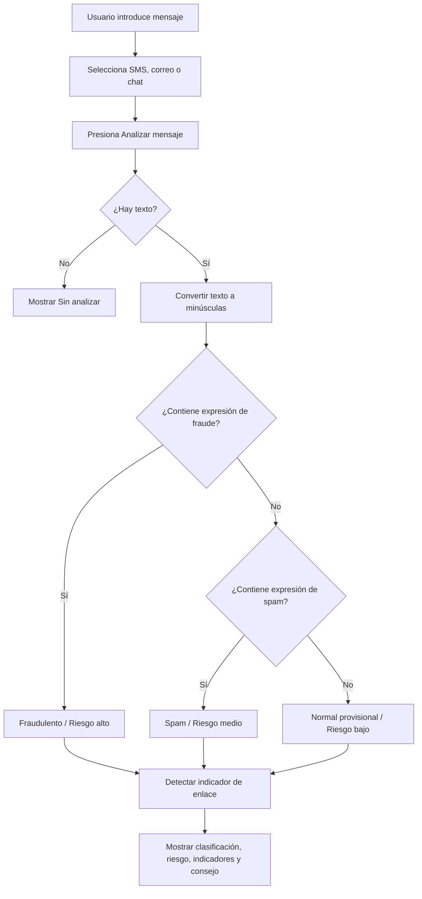

# Documentación del prototipo y de Gradio

**Proyecto 5: Detector de spam o mensajes fraudulentos**  
Materia: Fundamentos de Inteligencia Artificial  
**Estado:** primera etapa / demostración funcional, sin modelo entrenado.

## 1. Objetivo del prototipo

El proyecto busca ofrecer una referencia sencilla para que las personas identifiquen mensajes que podrían ser normales, publicidad no deseada (spam) o intentos de fraude. Se dirige especialmente a usuarios poco familiarizados con la tecnología y con conceptos de seguridad digital.

En la primera etapa, el objetivo de programación **no es detectar fraudes con precisión**, sino construir una interfaz en Python que permita completar el flujo:

1. El usuario introduce un mensaje.
2. Selecciona si llegó por SMS, correo electrónico o chat.
3. Presiona **Analizar mensaje**.
4. El programa ejecuta reglas **temporales** sobre el texto.
5. La interfaz muestra clasificación, nivel de riesgo, indicadores y recomendación.

El profesor permite simular los resultados antes de integrar el modelo de IA de unidades posteriores.

## 2. ¿Qué es Gradio?

**Gradio** es una biblioteca de Python de código abierto para construir interfaces web interactivas que ejecutan funciones de Python. Se utiliza frecuentemente para presentar demostraciones de modelos de aprendizaje automático, pero **también funciona con programas que todavía no incluyen IA**.

Con Gradio podemos crear elementos como cuadros de texto, selectores y botones desde Python, sin desarrollar por separado una página con HTML, CSS y JavaScript.

### ¿Cómo funciona Gradio?

Gradio conecta tres partes:

```text
Navegador (interfaz)
        |
        | El usuario escribe y presiona un botón
        v
Gradio recibe los valores de entrada
        |
        | Llama a una función de Python
        v
Función que procesa los datos
        |
        | Devuelve uno o varios resultados
        v
Gradio actualiza los componentes de salida
```

En nuestro caso, el servidor de Gradio se inicia al ejecutar `python app.py`. La página se abre localmente en el navegador mediante la dirección indicada en la terminal (normalmente `http://127.0.0.1:7860`).

### ¿Por qué se utiliza en este proyecto?

- Cumple la tecnología solicitada: **interfaz en Python/Gradio**.
- Permite mostrar entradas y resultados de forma clara.
- Separa la apariencia de la aplicación de la función que clasifica.
- Facilita sustituir las reglas provisionales por un modelo entrenado sin rehacer toda la interfaz.

**Aclaración:** Gradio **no es por sí mismo** el algoritmo que reconoce spam. Es la herramienta que presenta la interfaz y conecta sus controles con el análisis realizado en Python.

## 3. Tecnologías utilizadas

| Tecnología | Función en el proyecto |
| --- | --- |
| Python | Implementa las funciones y la lógica del prototipo. |
| Gradio | Crea la interfaz web e interconecta entradas, eventos y resultados. |
| Entorno virtual `.venv` | Mantiene las dependencias del proyecto aisladas. |
| Navegador web | Permite interactuar con la aplicación en el equipo. |

En esta etapa **no se utiliza una base de datos ni un modelo de aprendizaje automático**.

## 4. Organización del archivo `app.py`

La versión inicial usa un solo archivo para facilitar el aprendizaje. Está dividida conceptualmente en tres bloques.

### 4.1 Función `analizar_mensaje(mensaje, canal)`

Recibe:

- `mensaje`: texto introducido por el usuario.
- `canal`: opción seleccionada (`SMS`, `Correo` o `Chat`).

Devuelve **cuatro valores**, en este orden:

1. Clasificación.
2. Nivel de riesgo.
3. Indicadores encontrados.
4. Recomendación.

**Importante:** `canal` se recibe pero **todavía no interviene en las reglas**. Sirve como campo de interfaz que podrá considerarse más adelante.

### 4.2 Función `limpiar()`

Devuelve valores para restablecer los **seis** componentes vinculados al botón Limpiar:

1. Mensaje vacío.
2. Canal `SMS`.
3. Clasificación vacía.
4. Riesgo vacío.
5. Indicadores vacíos.
6. Recomendación vacía.

No elimina archivos ni registros: simplemente restablece los valores visibles de la interfaz.

### 4.3 Construcción y lanzamiento de la interfaz

La estructura comienza con:

```python
import gradio as gr

with gr.Blocks(title="Detector de spam", analytics_enabled=False) as demo:
    # Aquí se crean los componentes visuales.
    ...

if __name__ == "__main__":
    demo.launch(server_name="127.0.0.1", share=False)
```

- `import gradio as gr` permite acceder a los componentes mediante el alias `gr`.
- `gr.Blocks()` organiza una aplicación con varios componentes y eventos.
- `analytics_enabled=False` desactiva la telemetría básica de Gradio para esta instancia; **no es una garantía absoluta de privacidad o ausencia de registros**.
- `demo.launch(...)` inicia el servidor web de la demostración.
- `server_name="127.0.0.1"` limita el acceso de red al equipo local.
- `share=False` evita solicitar un enlace público compartido desde Gradio.

## 5. Componentes de Gradio utilizados

| Componente | ¿Qué hace? | Uso en el proyecto |
| --- | --- | --- |
| `gr.Blocks()` | Permite construir una página con varios controles. | Contenedor principal. |
| `gr.Markdown()` | Muestra títulos, descripciones y avisos. | Encabezado e indicación de que los resultados son simulados. |
| `gr.Row()` | Distribuye componentes de forma horizontal. | Separa entrada y resultados y organiza los botones. |
| `gr.Column()` | Agrupa componentes verticalmente. | Agrupa la captura y agrupa las salidas. |
| `gr.Textbox()` | Captura o muestra texto. | Mensaje, clasificación, riesgo, indicadores y recomendación. |
| `gr.Radio()` | Permite elegir una opción. | Canal de recepción del mensaje. |
| `gr.Button()` | Genera un control que puede activar un evento. | Botones Analizar mensaje y Limpiar. |

Los campos de salida usan `interactive=False` para que el usuario no los modifique directamente en la interfaz.

## 6. Eventos: cómo se conectan los botones

Gradio utiliza eventos como `.click()` para ejecutar una función cuando el usuario presiona un botón. La conexión esencial del prototipo es:

```python
boton_analizar.click(
    fn=analizar_mensaje,
    inputs=[mensaje, canal],
    outputs=[clasificacion, riesgo, indicadores, recomendacion]
)
```

Su lectura es:

1. **`fn`** indica qué función de Python ejecutar.
2. **`inputs`** indica de qué componentes leer los valores.
3. **`outputs`** indica en qué componentes escribir cada valor devuelto.

La función devuelve **cuatro resultados** porque en `outputs` se especificaron cuatro componentes. El orden debe coincidir.

El botón Limpiar sigue la misma idea, pero ejecuta `limpiar()` y actualiza seis componentes. No necesita entradas: `inputs=[]`.

## 7. Cómo clasifica el prototipo actual

La lógica actual es un **sistema de coincidencias de texto**, no un clasificador inteligente.

### Paso 1. Comprobar que existe un mensaje

Si el cuadro está vacío o contiene solo espacios, se presenta el resultado **Sin analizar** y se pide ingresar un texto.

### Paso 2. Normalizar mayúsculas

Se usa:

```python
texto = mensaje.lower()
```

Esto facilita buscar las mismas expresiones sin distinguir entre letras mayúsculas y minúsculas. **No** realiza una normalización lingüística completa: sigue siendo sensible a tildes, variaciones de redacción y errores ortográficos.

### Paso 3. Comparar expresiones predefinidas

En el código inicial aparecen dos grupos:

**Señales de posible fraude:**

- `verifica tu cuenta`
- `contraseña`
- `datos bancarios`
- `cuenta será bloqueada`
- `transferencia urgente`

**Señales de spam:**

- `oferta`
- `descuento`
- `promoción`
- `premio`
- `gratis`

El código revisa si alguna de esas expresiones está contenida en el mensaje.

### Paso 4. Asignar una salida provisional

| Condición | Clasificación | Riesgo |
| --- | --- | --- |
| Se detecta una o más expresiones del grupo de fraude | Potencialmente fraudulento | Alto (simulado) |
| No hay expresiones de fraude, pero sí alguna de spam | Spam | Medio (simulado) |
| No aparecen expresiones de ninguno de los dos grupos | Normal (provisional) | Bajo (simulado) |

**Prioridad:** si un mensaje contiene expresiones de ambas listas, se clasifica como **potencialmente fraudulento**, ya que la condición de fraude se comprueba primero.

No se calcula un porcentaje de confianza ni una probabilidad estadística. Los riesgos bajo, medio y alto son etiquetas fijas asociadas a las reglas.

### Paso 5. Revisar la presencia de enlaces

También se buscan las cadenas `https://`, `http://` o `www.`.

Si aparece alguna, se agrega el indicador **«contiene un enlace»** y una advertencia de precaución. **La presencia de un enlace por sí sola no cambia la clasificación o el riesgo** en la implementación actual.

### Paso 6. Presentar la recomendación

La recomendación varía según la clasificación: verificar fuentes oficiales, evitar responder a publicidad no deseada y no compartir contraseñas ni datos bancarios.

Estas recomendaciones son orientativas y no prueban que un mensaje sea legítimo o fraudulento.

## 8. Diagrama del funcionamiento



Esta representación corresponde a la **versión con reglas temporales**, no al procesamiento futuro mediante aprendizaje automático.

## 9. Entradas y salidas

### Entradas actuales

| Entrada | Tipo de dato | Descripción |
| --- | --- | --- |
| Texto del mensaje | Cadena (`str`) | Contenido completo introducido por el usuario. |
| Canal | Opción categórica (`str`) | `SMS`, `Correo` o `Chat`; por ahora no altera el análisis. |

La presencia de URL se detecta dentro del texto; no se captura en un campo separado. La longitud del mensaje, aunque figura como variable auxiliar posible en la documentación inicial, **todavía no se utiliza**.

### Salidas actuales

| Salida | Tipo de dato | Ejemplo |
| --- | --- | --- |
| Clasificación | Texto | `Spam` |
| Nivel de riesgo | Texto | `Medio (simulado)` |
| Indicadores | Texto | `oferta, descuento` |
| Recomendación | Texto | `Evita responder a mensajes publicitarios inesperados...` |

## 10. Ejemplos de prueba

| Entrada ficticia | Resultado provisional esperado | Motivo |
| --- | --- | --- |
| `Hola, nos vemos mañana.` | Normal | No coincide con las expresiones definidas. |
| `Tenemos una oferta y descuento para ti.` | Spam | Contiene `oferta` y `descuento`. |
| `Verifica tu cuenta y comparte tu contraseña.` | Potencialmente fraudulento | Contiene expresiones de la lista de fraude. |
| `Visita https://ejemplo.test para consultar información.` | Normal con indicador de enlace | El enlace agrega una señal, pero no modifica la clase. |
| Texto vacío | Sin analizar | Falta la entrada principal. |

También se debe probar **Limpiar**, comprobando que todos los resultados desaparezcan y que el canal regrese a `SMS`.

## 11. Limitaciones y precauciones

1. **No existe IA entrenada** en esta fase: únicamente reglas codificadas manualmente.
2. La detección usa coincidencias textuales y **no comprende el contexto**. Por ejemplo, una conversación legítima sobre cambiar una contraseña puede marcarse como sospechosa.
3. Puede no reconocer fraudes reales que utilicen otras palabras, abreviaciones, errores de escritura u otras lenguas.
4. El nivel de riesgo es simulado; **no representa una probabilidad ni una medida de precisión**.
5. El canal se captura pero aún no participa en la decisión.
6. Los enlaces no son visitados, evaluados ni verificados. Solo se detecta la presencia de ciertas cadenas.
7. El prototipo no escribe los mensajes en una base de datos ni en archivos propios, pero eso **no equivale a una garantía absoluta de que ningún componente del entorno registre información temporalmente**. Para la evidencia del proyecto, utilizar únicamente mensajes de ejemplo sin datos personales.
8. El diseño está pensado como ayuda para usuarios con poca familiaridad tecnológica, **no como sustituto de verificaciones oficiales ni decisiones de seguridad**.

## 12. Relación con las ramas de IA estudiadas

La documentación del equipo propone:

- **Procesamiento del Lenguaje Natural (PLN):** para preparar y representar mensajes escritos por personas.
- **Aprendizaje automático supervisado:** para aprender a diferenciar clases a partir de ejemplos etiquetados.
- **Posible sistema híbrido:** un modelo de aprendizaje automático acompañado de reglas explicativas para mostrar señales de alerta.

En la **primera etapa**, las reglas provisionales permiten mostrar cómo circularán los datos. La clasificación automática mediante un modelo entrenado **sigue siendo trabajo futuro**.

## 13. Mejoras previstas para otras unidades

La evolución esperada del proyecto puede organizarse de esta forma:

1. Obtener mensajes etiquetados de fuentes públicas y revisar sus condiciones de uso.
2. Preparar los datos, considerando idioma, privacidad y equilibrio entre clases.
3. Definir y seleccionar características útiles del texto, como palabras, expresiones, longitud y presencia de enlaces.
4. Entrenar y evaluar un modelo supervisado cuando corresponda a la siguiente etapa académica.
5. Sustituir las reglas de clasificación dentro de `analizar_mensaje()` por llamadas al modelo, manteniendo la conexión de Gradio con las entradas y salidas.
6. Revisar los indicadores y las recomendaciones para que expliquen el resultado sin presentar certezas falsas.

**Nota sobre los datos:** la documentación inicial menciona SMS Spam Collection, SpamAssassin y Enron como posibles fuentes. Su empleo requiere revisar licencias, idiomas y etiquetado. No se debe dar por hecho que esas fuentes contienen las tres clases requeridas.

## 14. Fuentes y documentación de referencia

### Archivos proporcionados para el proyecto

- **Proyecto 5 (1).pdf:** enunciado oficial y requisitos de la primera etapa.
- **IA proyecto .pdf:** descripción del problema, usuarios, ramas de IA, enfoque, datos, privacidad, flujo e interfaz esperada.
- **Inteligencia artificial _261026_161216.PDF:** apuntes de Fundamentos de Inteligencia Artificial.

### Documentación de Gradio

- Introducción y primeros pasos: https://www.gradio.app/guides/quickstart
- Referencia de `Blocks`: https://www.gradio.app/docs/gradio/blocks
- Documentación general: https://www.gradio.app/docs

---

**Resumen:** el prototipo construye una interfaz web con Gradio y demuestra un flujo de análisis basado en reglas de texto. Su valor en esta etapa es validar la interacción y las salidas esperadas; el modelo de inteligencia artificial se incorporará después.
