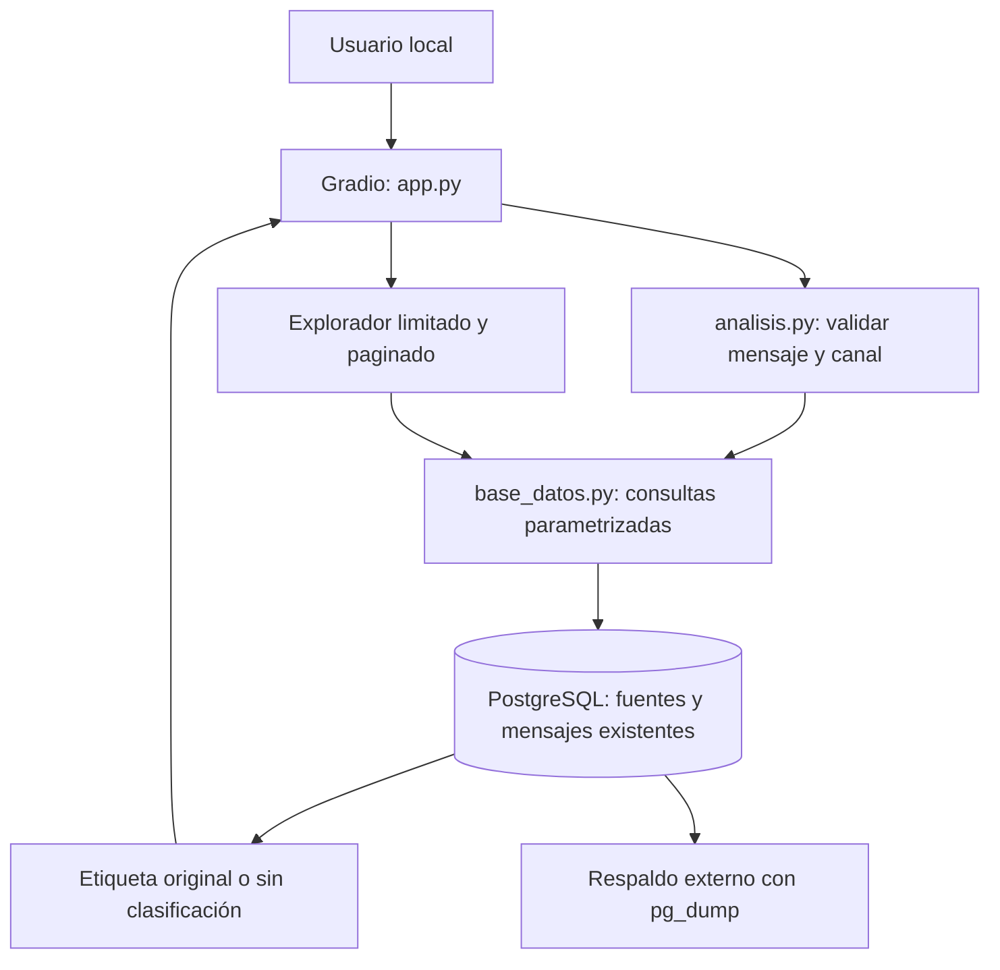

# Documentación técnica: consulta exclusiva

Proyecto 5 · Fundamentos de Inteligencia Artificial · Universidad Tecnológica de Querétaro.

## Arquitectura actual

Las rutas de archivos mencionadas se interpretan desde la raíz del proyecto, donde están `app.py` y `requirements.txt`; los enlaces Markdown se resuelven desde el documento que los contiene. No dependen de una unidad, nombre de usuario o carpeta de instalación concreta. Las direcciones de red de PostgreSQL se configuran por integrante mediante `./.env`.

| Archivo | Función |
| --- | --- |
| app.py | Interfaz, eventos y ocultación parcial de ejemplos |
| analisis.py | Consulta de coincidencias y explicación del resultado |
| base_datos.py | Conexión de solo lectura, normalización y consultas |
| iniciar_postgresql.ps1 | Inicio de la instancia local existente |
| tools/exportar_dump.py | Respaldo con pg_dump oficial |
| tools/importar_bd.py | Restauración administrativa en una base nueva y vacía |
| tools/probar_app.py | Comprobaciones de lectura y controles de Gradio |

El iniciador local resuelve `./datos/postgresql/` desde su propia ubicación y busca `pg_ctl` en el `PATH`. Solo sirve para una instancia ya creada allí; si PostgreSQL funciona como servicio o en otra ubicación, el equipo configura esa conexión en `./.env` sin utilizar el iniciador. No se comparte la carpeta de datos de un servidor activo ni el entorno virtual entre equipos; se usa el dump para transferir la base y se configura una cuenta de lectura en cada instalación.

La versión anterior permitía importaciones y reglas provisionales. Por solicitud del usuario, esta versión solo consulta los datos ya presentes. Se retiraron de la carpeta activa los importadores, las utilidades de carga, las reglas y el esquema de creación. No se eliminó ningún registro de PostgreSQL.

## Protección de escritura

La URL de la aplicación usa `antispam_lectura`, sin privilegios de superusuario, creación de roles o bases y sin pertenencia al propietario. Tiene CONNECT, USAGE del esquema público y SELECT sobre fuentes y mensajes. No tiene INSERT, UPDATE, DELETE, TRUNCATE ni creación de tablas. Se retiró CREATE del esquema público y TEMPORARY de PUBLIC para esta base. La cuenta anterior propietaria tiene NOLOGIN.

El rol tiene default_transaction_read_only activado y psycopg establece read_only en cada conexión. Esas protecciones de sesión no reemplazan los privilegios: aunque se desactiven, el rol sigue sin poder escribir. La credencial administrativa se conserva exclusivamente para mantenimiento en `.env.postgres-local`; no se carga desde la aplicación. Los administradores de PostgreSQL pueden gestionar la base, por lo que no se afirma que los datos sean inmutables frente a un administrador.

No existen funciones de creación de esquema, registro de fuentes o inserción en base_datos.py. El análisis, la exploración y Limpiar solo leen o modifican componentes de interfaz. No hay incorporación automática de mensajes ni entrenamiento.

## Modelo relacional conservado

`fuentes` identifica cada corpus por ID, código único, nombre, URL oficial, descripción, condiciones de uso, versión conocida y fecha de importación. `mensajes` conserva ID, referencia a fuente, identificador original, canal, contenido, asunto opcional, etiqueta nullable, hash, representación normalizada, metadatos JSONB y fecha de importación.

La unicidad por fuente e identificador mantiene la procedencia; las claves foráneas protegen la relación. Los índices existentes sirven para canal/hash y fuente/etiqueta/ID. No se modifican tablas durante el arranque. Almacenar y consultar textos no equivale a entrenar un modelo.

## Flujo de consulta

1. Se valida que haya texto y que el canal sea SMS, Correo o Chat.
2. El texto se normaliza con NFKC, casefold y compactación de espacios; no se elimina puntuación ni tildes.
3. Se consulta PostgreSQL mediante parámetros. Se comprueban hash y texto normalizado dentro del canal seleccionado.
4. Si las coincidencias tienen una única etiqueta original, se muestra ham o spam, las fuentes y el canal, aclarando que es una consulta y no una predicción. No se infiere riesgo de seguridad de esa etiqueta.
5. Sin coincidencia, sin etiqueta o con etiquetas contradictorias se informa Sin clasificación y Sin determinar para el riesgo.
6. Sin conexión no se fabrica un resultado ni se ejecutan reglas de respaldo.

Una coincidencia textual no garantiza seguridad: puede reutilizarse el mismo texto en otros contextos. No hay coincidencias aproximadas presentadas como verdaderas, probabilidades o porcentajes de precisión.

## Gradio

Blocks organiza las pestañas de consulta y exploración. Textbox captura texto y muestra cinco salidas de solo lectura. Radio filtra realmente por canal. Los botones Analizar mensaje y Limpiar conectan funciones mediante click. Dropdown, Number y Dataframe implementan filtros y páginas de diez ejemplos. La exploración requiere pulsar Buscar; no muestra ejemplos automáticamente.

Gradio escucha únicamente en 127.0.0.1 con share=False y analytics_enabled=False. El sistema no guarda los mensajes del usuario. Esto no es una garantía de ausencia de memoria temporal del navegador o registros de infraestructura; evite información sensible.

## Fuentes y privacidad

- [UCI SMS Spam Collection](https://archive.ics.uci.edu/dataset/228/sms+spam+collection): Almeida e Hidalgo; DOI 10.24432/C5CC84, CC BY 4.0. Se conservan 5,574 SMS con etiquetas originales ham/spam y su atribución.
- [Apache SpamAssassin Public Corpus](https://spamassassin.apache.org/old/publiccorpus/) y [condiciones](https://spamassassin.apache.org/old/publiccorpus/readme.html): se conservan 6,024 correos de cinco categorías. Easy_ham, easy_ham_2 y hard_ham corresponden a ham; spam y spam_2 a spam. Los remitentes conservan el copyright y el corpus no debe reenviarse a sistemas de correo activos. Hubo 22 rechazos durante el procesamiento original.
- [CMU Enron Email Dataset](https://www.cs.cmu.edu/~enron/): fuente prevista pero no importada. No se considera ham por defecto y sus originales carecen de etiquetas binarias de spam. CMU pide sensibilidad respecto a la privacidad; la disponibilidad pública no implica permiso universal de redistribución.

Los ejemplos de UCI y SpamAssassin están limitados a 240 caracteres y ocultan correos, números largos y URLs. Pueden quedar nombres u otros datos: es una ocultación parcial, no anonimización completa. Enron, si ya existiera en una base configurada, mostraría solo metadatos y nunca su contenido o asunto. La interfaz no permite buscar dentro de su cuerpo.

Los corpus históricos, mayoritariamente ingleses, no representan necesariamente mensajes actuales en español. Ham/spam no equivalen a una clasificación de fraude. No se redistribuyan datos, capturas o respaldos sin revisar derechos y privacidad.

## Verificación y mantenimiento

La comprobación de funcionamiento se realiza desde la interfaz: conexión de solo lectura, totales por fuente, consulta de etiquetas existentes, mensajes ausentes y botón Limpiar. La versión simplificada no incluye herramientas de revisión de código, automatizaciones de GitHub ni una suite de pruebas; para ejecutar basta con las dependencias de requirements.txt.

Las utilidades administrativas y el comprobador sencillo están en `./tools/`, con sus instrucciones en [tools/GUIA_TOOLS.md](../tools/GUIA_TOOLS.md). La app no importa estos scripts. La restauración requiere RESTORE_DATABASE_URL y una base nueva sin objetos; nunca utiliza automáticamente la conexión de lectura DATABASE_URL. No se reintroducen importadores de datasets ni dependencias de desarrollo.

[README.md](../README.md), en la raíz del proyecto, contiene los comandos de ejecución y respaldo. Este documento y los respaldos se agrupan en `Documentacion/`: `antispam-completo.dump` contiene el esquema y todos los registros actuales, y `respaldo-inicial.dump` conserva la copia anterior. La guía de herramientas permanece en `tools/GUIA_TOOLS.md` y la portada complementaria en `.github/PORTADA.md`. Los dumps no incluyen contraseñas ni roles globales y permanecen excluidos de Git.

Las credenciales, el entorno, los datos persistentes, el respaldo y los registros activos se conservan; cachés, configuración vacía del editor y descargas ya importadas se retiraron a la Papelera. El proyecto no incluye entrenamiento ni modelos guardados. Cualquier incorporación futura de datasets o Machine Learning requerirá una nueva etapa expresamente autorizada.
